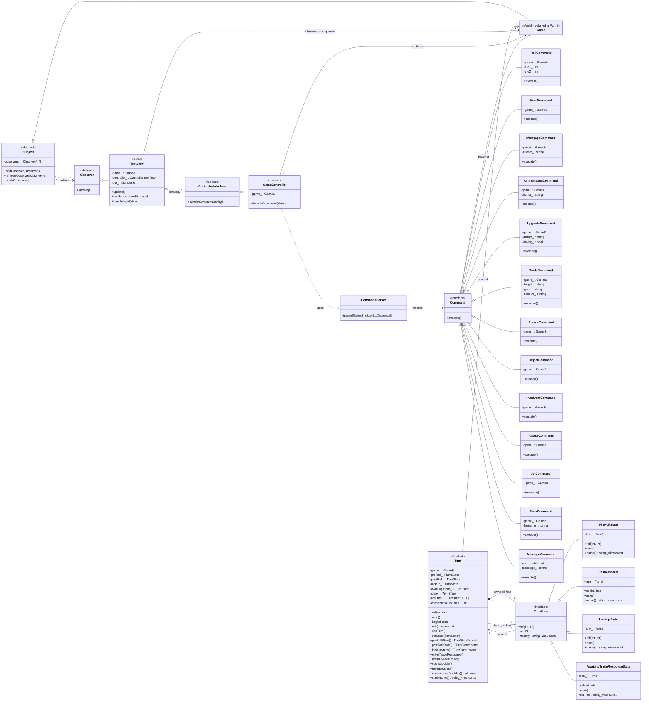
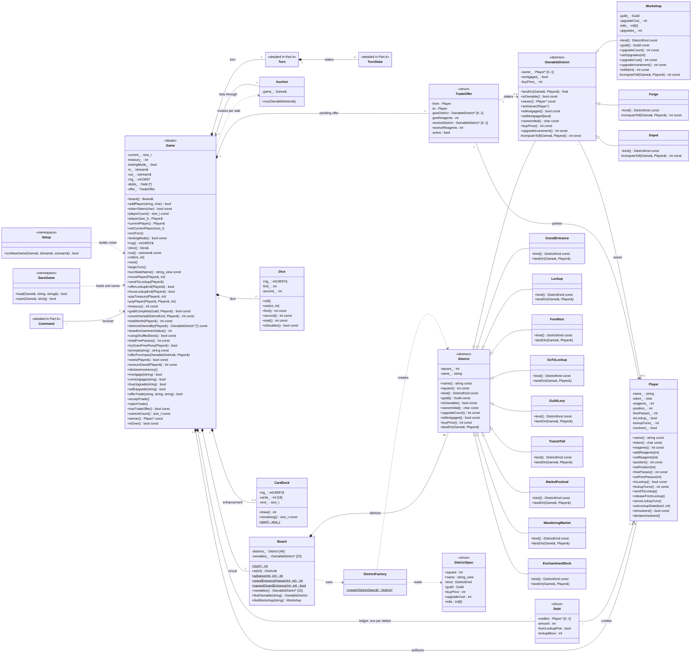
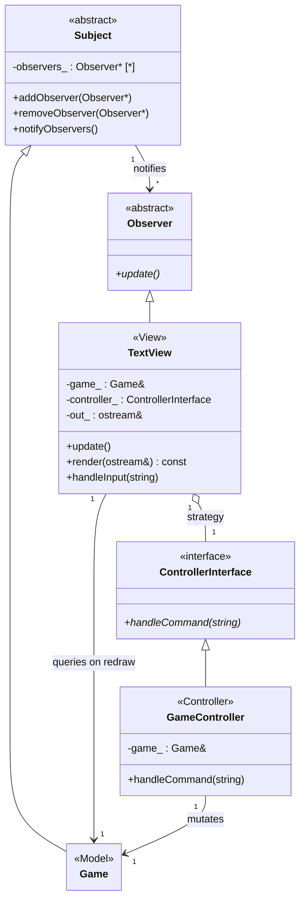
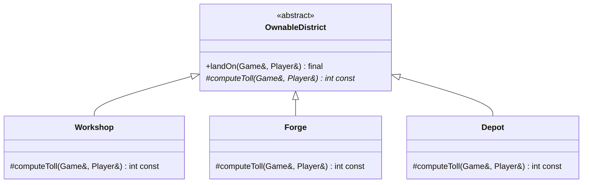
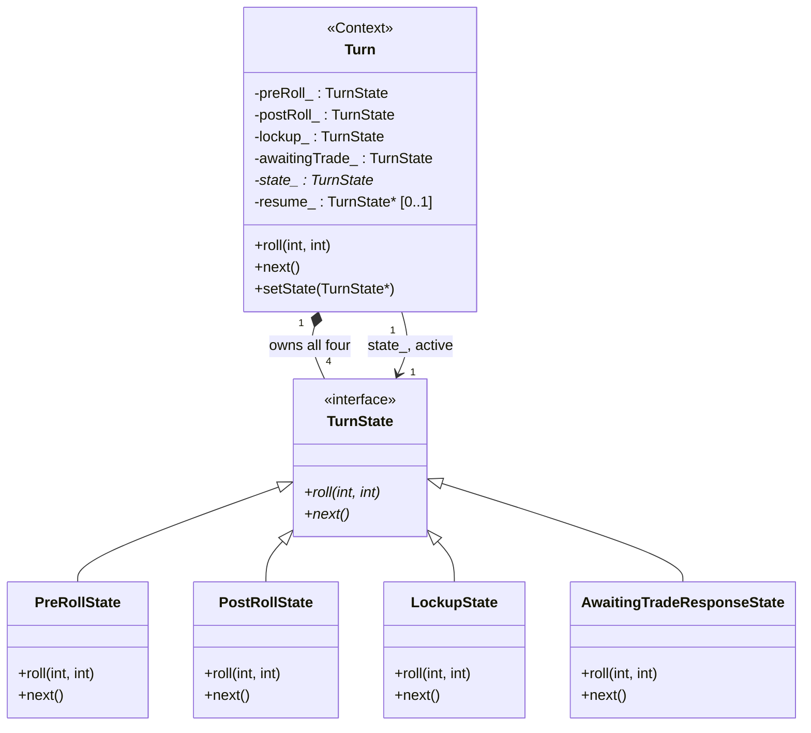
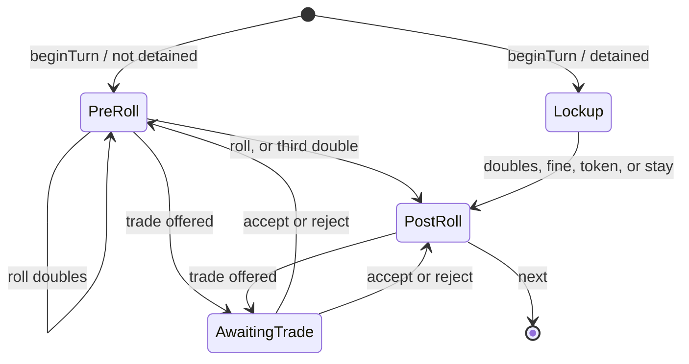
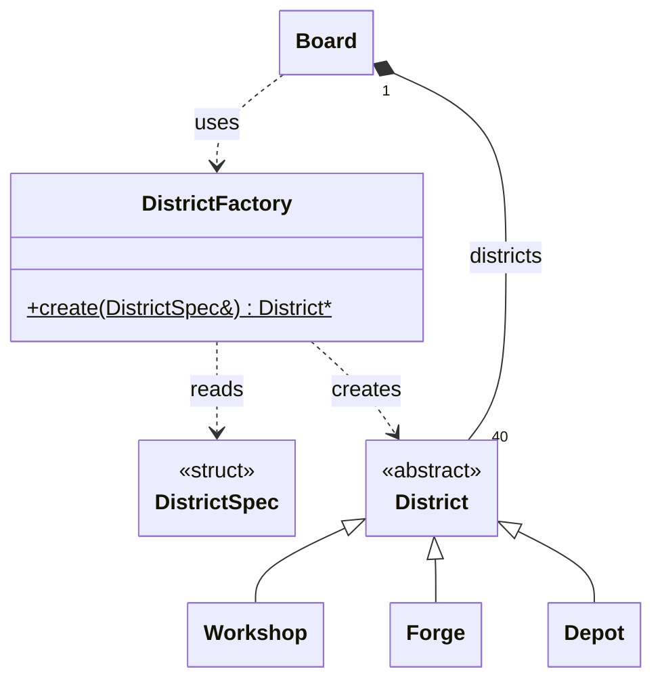

# ArcaneMarket — UML class diagrams

Reflects the final submitted code.

## How these are organised

**Figures 1A and 1B together are the class diagram.** It is too large for one page, so it is
split into two clearly labelled parts, as permitted. Every major class appears in exactly one
part with its key attributes and its full public interface; where a relationship crosses the
split, the far class appears as a name-only box marked with the part that details it.

- **Part A — Application and control:** Observer infrastructure, View, Controller, the command
  interpreter, and the turn state machine.
- **Part B — Domain model:** `Game` and its economy, the circuit, the district hierarchy, and
  persistence.

**Figures 2–7 are supplementary per-pattern views**, referenced from the Design Patterns section
of the report. They repeat classes already in 1A/1B, reduced to just the participants in one
pattern so the pattern's shape is visible without tracing it out of the full diagram.

Following Chapter 8, method **parameters are not associations** — `landOn(Game&, Player&)` passes
references at call time, which the chapter explicitly excludes. Only stored references and
pointers are drawn as lines.

## Notation (Chapter 8)

| Symbol | Meaning | C++ here |
|---|---|---|
| `+ - #` | public / private / protected | |
| *italics* | pure virtual | `= 0` |
| <u>underline</u> | static | `static` |
| `const` | query operation | `... const` |
| ◁—— | **inheritance** (generalization) | `class B : public A` |
| ◆—— | **composition** | by value or `unique_ptr` |
| ◇—— | **aggregation** | `shared_ptr` |
| ——▶ | association | stored reference or non-owning pointer |
| ⋯▶ | **dependency** | creates / uses |

---

## Figure 1A — Class diagram, Part A: application and control

`Game` is shown name-only here; it is detailed in Part B.

---

## Figure 1B — Class diagram, Part B: domain model

`Turn`, `TurnState` and `Command` are shown name-only here; they are detailed in Part A.

Crafting Guild membership is a value (`enum class Guild`) carried by each `Workshop`, not a
class, so guild size appears as a rule rather than a multiplicity: Ember has 4 Workshops, Smoke
3, Arcane 4, Gilded 5. `Game::guildComplete` counts the actual membership rather than assuming a
fixed size.

---

## Figure 2 — MVC + Observer (supplementary)

---

## Figure 3 — Template Method (supplementary)

`landOn` is `final` and fixes the sequence — unowned? owned by the visitor? mortgaged? otherwise
charge — while `computeToll` is the only step that varies.

---

## Figure 4 — State (supplementary)

---

## Figure 5 — Turn phase transitions

---

## Figure 6 — Command (supplementary)

Three of the thirteen commands, chosen to show the range of bound arguments. All thirteen appear
in Figure 1A.

---

## Figure 7 — Simple Factory (supplementary)

One concrete creator with a static operation and **no creator hierarchy** — that absence is what
separates the Simple Factory idiom from GoF Factory Method.
