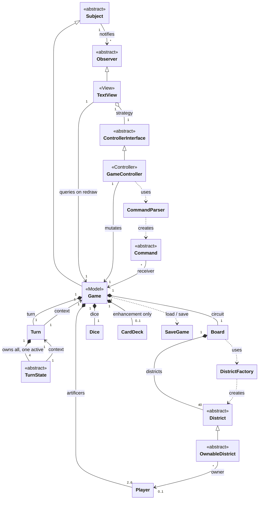
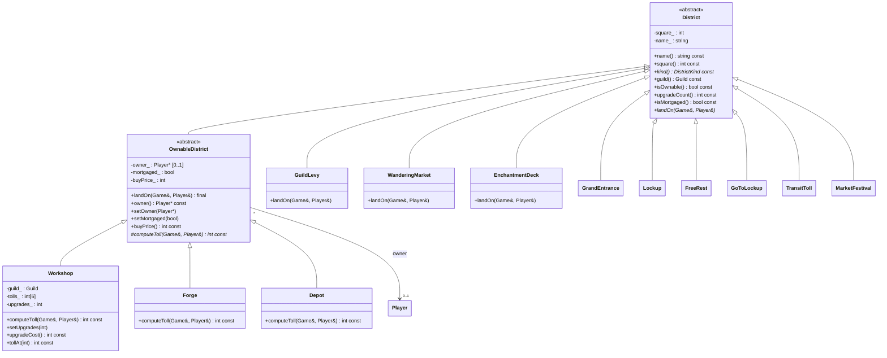
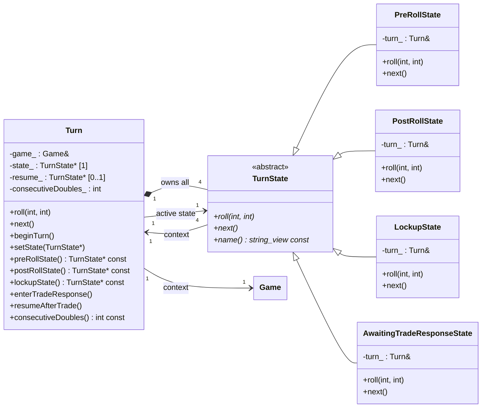
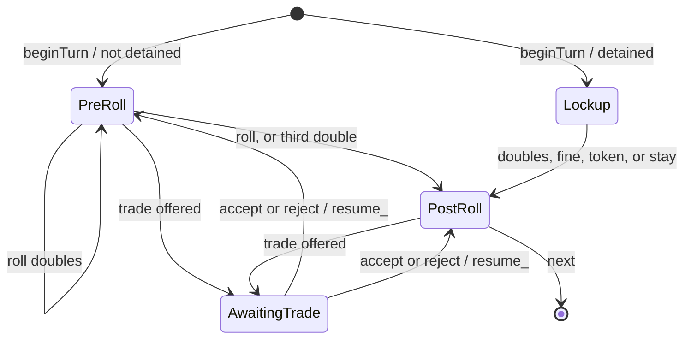
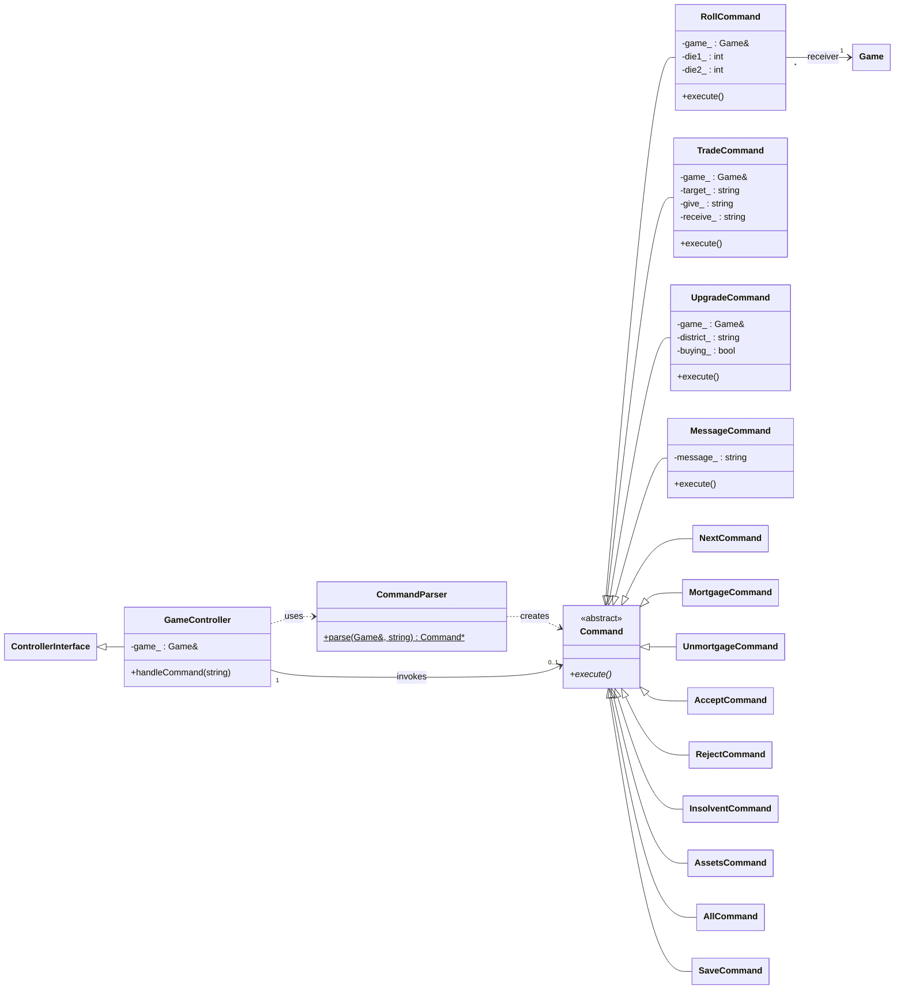
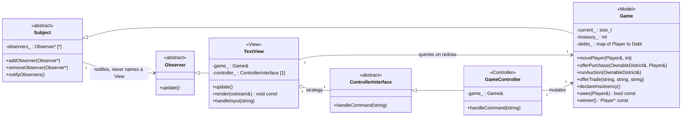

# ArcaneMarket — UML class diagrams

Reflects the final submitted code. Render at <https://mermaid.live> and export PNG/SVG for `report1.pdf`.

## Notation (Chapter 8)

| Symbol | Meaning | C++ realisation here |
|---|---|---|
| `+ - #` | public / private / protected | |
| *italic* | pure virtual | `= 0` |
| <u>underline</u> | static | `static` |
| `{query}` | const member function | `... const` |
| ◁—— | generalization | `class B : public A` |
| ◆—— | **composition** — part belongs to exactly one whole, lifetime tied | by value or `unique_ptr` |
| ◇—— | **aggregation** — part is independent, may belong to several wholes | `shared_ptr` or raw pointer |
| ——▶ | association with navigation | non-owning reference or raw pointer |
| ⋯▶ | dependency | creates / uses |

Chapter 8 warns that *"a final diagram should not leave multiplicities blank"*, so every
association below carries multiplicities at both ends.

Boxes are drawn at two levels of abstraction, which the chapter sanctions
(*"match the level of detail to the conversation"*): the overview names classes and
relationships, the per-pattern diagrams are fully decorated.

---

## 1. Overview — the whole structure

**Why each diamond is the shape it is**, using the chapter's decision procedure:

- `Game ◆— Board`, `◆— Dice` — held by value, destroyed with the Game. Composition.
- `Game ◆— Player`, `◆— Turn`, `◆— CardDeck`, `Board ◆— District`, `Turn ◆— TurnState` —
  `unique_ptr`, which the chapter calls *"the key signal of composition"*.
- `TextView ◇— ControllerInterface` — `shared_ptr`. The Controller does not die with the
  View, so this is aggregation, matching Ch 17's own diagram.
- `Subject —▶ Observer` — a plain association, not a diamond: the observer list is
  non-owning raw pointers, so the Subject is not *made of* its Observers.
- `OwnableDistrict —▶ Player` — plain association with role name `owner`, multiplicity
  `0..1` because an unowned district holds `nullptr`.

---

## 2. District hierarchy — Template Method

`OwnableDistrict::landOn` is `final`: it fixes the order of a visit and defers only the
price to `computeToll`, the one varying step.

---

## 3. State — the turn phases

`Turn` is the Context. It owns all four states for its whole life and swaps a non-owning
`state_` pointer, so a transition allocates nothing. `resume_` records the phase a trade
offer interrupted, because an offer may be made before *or* after rolling.

Behaviour, as a UML state diagram:

---

## 4. Command — the interpreter

`GameController` is the Invoker and knows only the interface. `CommandParser` binds each
command's receiver and arguments at construction, per Ch 20. A `nullptr` return is the
graceful path for a misspelled verb.

`MessageCommand` is the only command with no receiver — it reports a refusal, which keeps
console output in the Command layer instead of pushing it into the parser.

---

## 5. MVC + Observer

Ch 17's arrangement, which is **not** the common one: the View owns the Controller as its
Strategy, the View registers as an Observer of the Model, and the View queries the Model
directly when redrawing. The Controller only handles user-initiated events.

