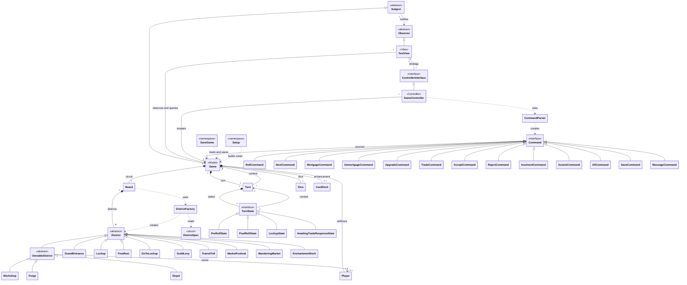
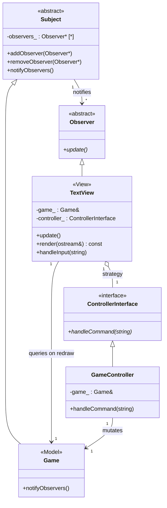
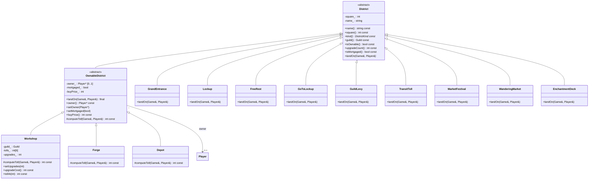
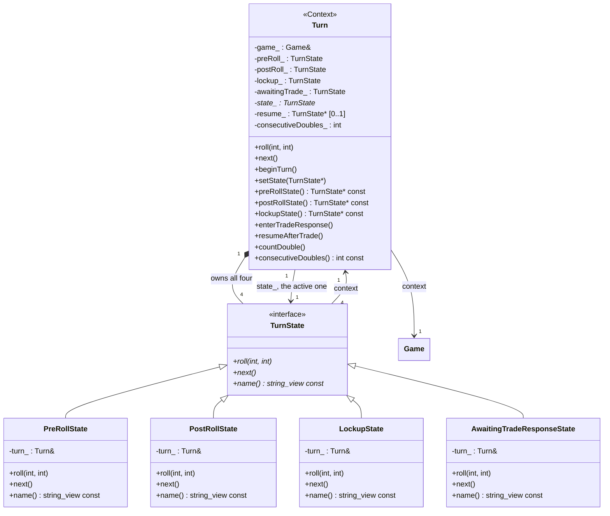
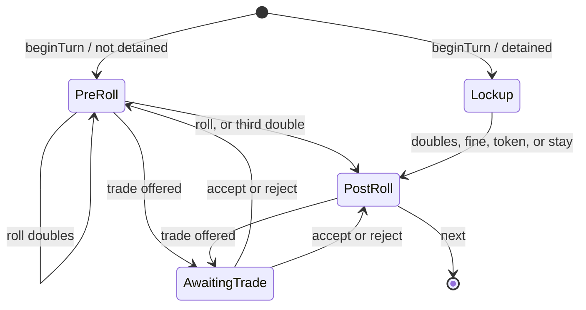
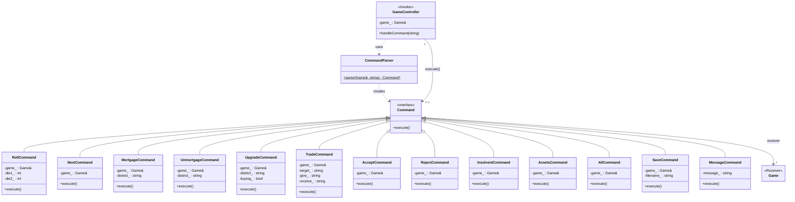
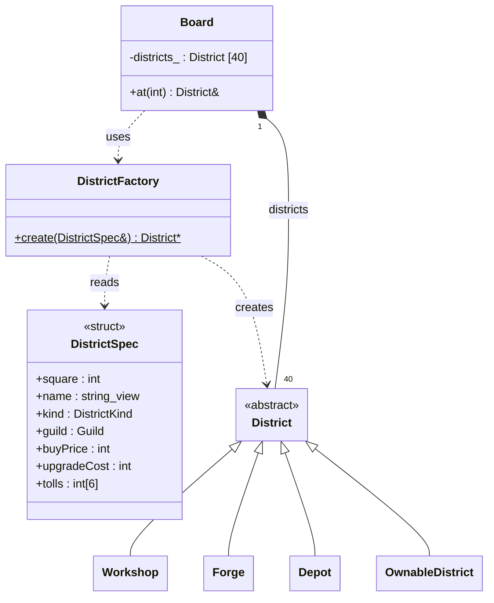
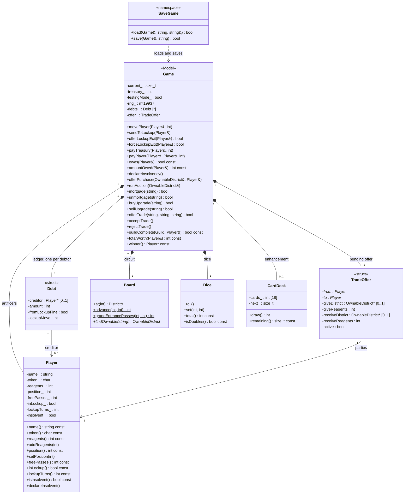

# ArcaneMarket — UML class diagrams

Reflects the final submitted code. Rendered images in `diagrams/`.

## How these are organised

**Figure 1 is a master class diagram**: every class in the program, names and relationships
only. It answers "what exists and what talks to what", so it carries no members.

**Figures 2–8 are detailed diagrams**, one per pattern or logical grouping. Each is complete for
its subject — every participating class, with the members that matter at that level of
abstraction. Nothing is dropped for tidiness: the Command figure shows all thirteen commands,
the district figure shows all thirteen districts.

Following Chapter 8, method **parameters are not associations** — `landOn(Game&, Player&)` passes
references at call time, which the chapter explicitly excludes ("the argument that one routine
passes to another … none of that is an association"). Only stored references and pointers appear
as lines.

## Notation (Chapter 8)

| Symbol | Meaning | C++ here |
|---|---|---|
| `+ - #` | public / private / protected | |
| *italics* | pure virtual | `= 0` |
| <u>underline</u> | static | `static` |
| `const` | query operation | `... const` |
| ◁—— | generalization | `class B : public A` |
| ◆—— | composition | by value or `unique_ptr` |
| ◇—— | aggregation | `shared_ptr` |
| ——▶ | association | stored reference or non-owning pointer |
| ⋯▶ | dependency | creates / uses |

Multiplicities appear at both ends of every association, since Chapter 8 notes that a final
diagram should not leave them blank.

---

## Figure 1 — Master class diagram

Every class in the program. Names and relationships only.

---

## Figure 2 — MVC + Observer

Chapter 17 treats MVC as a compound pattern, so it is one figure. What makes this MVC rather
than three arbitrary classes is the direction of every link: the **View owns the Controller** as
its strategy, the **View observes the Model**, the **View queries the Model directly** on
redraw, and the **Model names no View at all**.

`TextView` registers itself as an Observer in its constructor and deregisters in its destructor.
Notification fires once per command, from `GameController::handleCommand`, rather than from every
Model mutator — the spec redraws the whole board after each command, so the command is the real
unit of change.

---

## Figure 3 — District hierarchy and Template Method

All thirteen district classes. The Template Method lives on the ownable branch: `landOn` is
`final` and fixes the sequence of a visit, `computeToll` is the only step that varies. The nine
non-ownable districts override `landOn` directly and take no part in it.

The three `computeToll` overrides are genuinely different: `Workshop` indexes a six-entry table
by upgrade level and doubles an unimproved toll when the Guild is complete; `Forge` indexes a
levy table by how many Forges the owner holds; `Depot` multiplies the dice total by 4, or 10 when
one Artificer holds both.

---

## Figure 4 — State

The Context **owns every state for its whole life** and swaps a non-owning pointer, rather than
allocating on transition. `resume_` records the phase a trade offer interrupted, because an offer
may be made before *or* after rolling.

---

## Figure 5 — Turn phase transitions

---

## Figure 6 — Command

All thirteen commands. Each binds its receiver and its arguments as data members at
construction, which is what lets the Invoker fire any request through one interface without
knowing what it is.

`Command` declares `execute()` only. Chapter 20 adds `undo()` **when undo is required**, and
ArcaneMarket has none. `MessageCommand` is the single command with no receiver: it reports a
refusal, which keeps console output in the Command layer rather than in the parser.

---

## Figure 7 — Simple Factory

One concrete creator with a static operation and **no creator hierarchy**. That absence is the
point: it is what separates the Simple Factory idiom from the GoF Factory Method (Chapter 12).

---

## Figure 8 — Model internals

`Game` is the Model, and none of the pattern figures show what it actually holds. This is the
economy: Reagents, the Treasury, the per-Artificer debt ledger, and the pending trade offer.

A debt per Artificer, rather than one globally, is required because the insolvency settlement
charges mortgage fees to the **creditor** — who is not the Artificer taking the turn — so that
obligation has to outlive the turn that created it.
