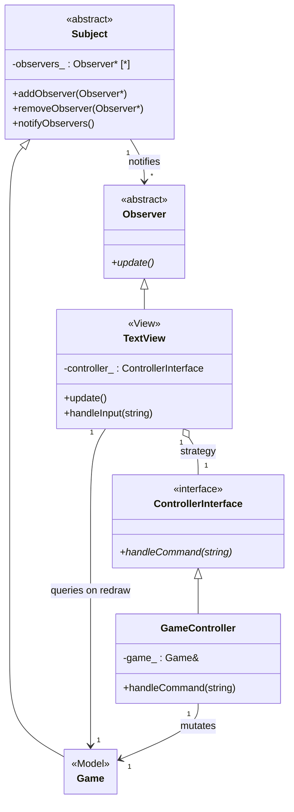
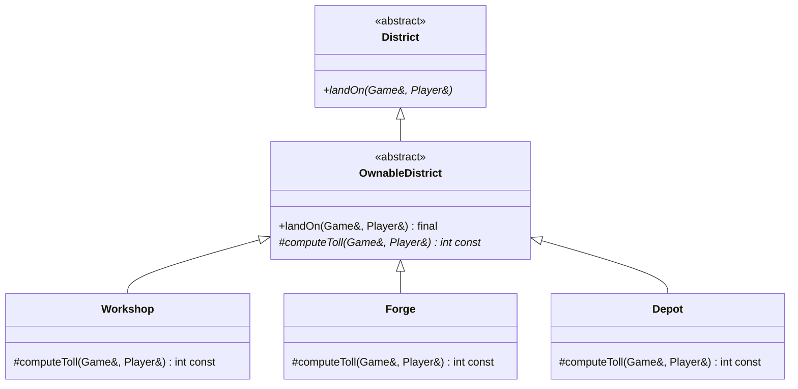
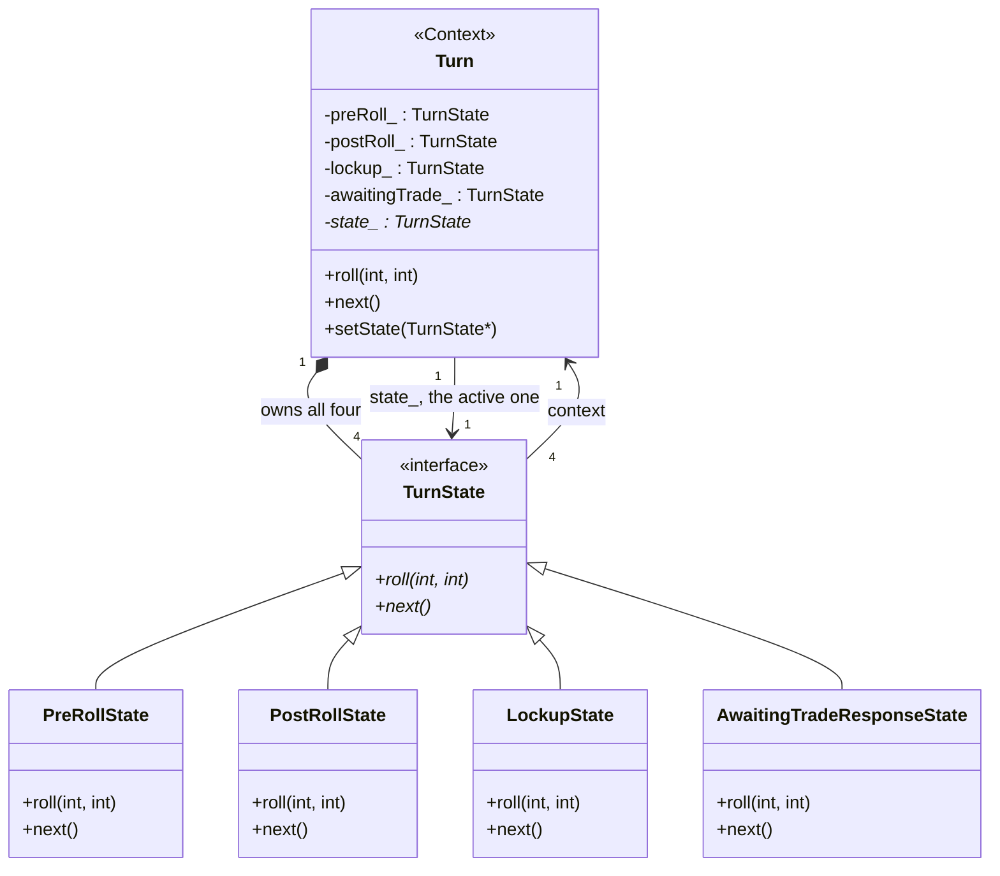
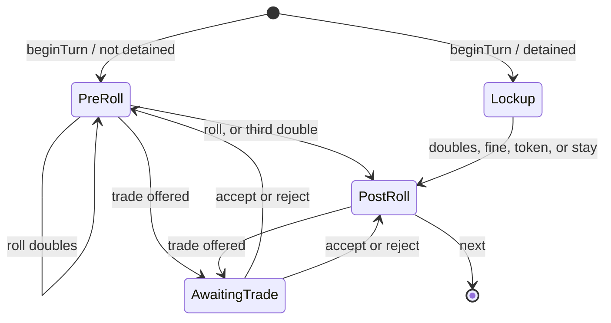
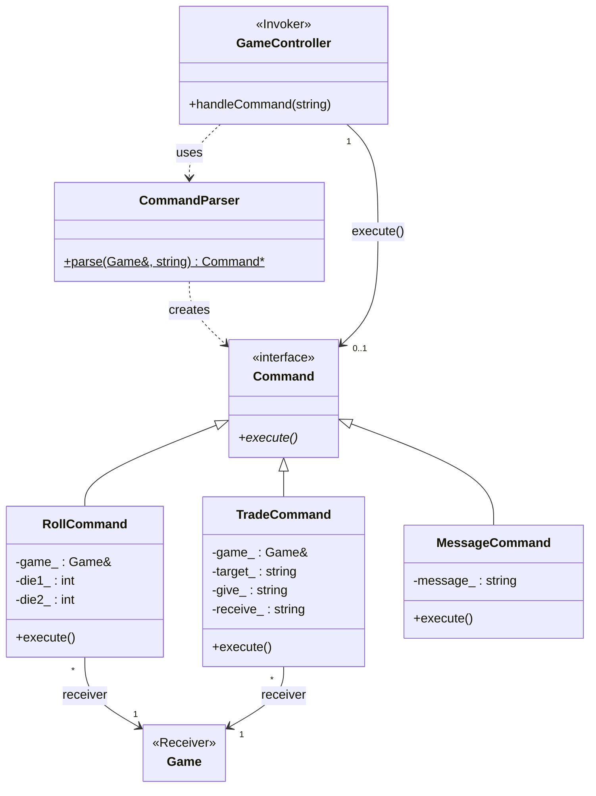
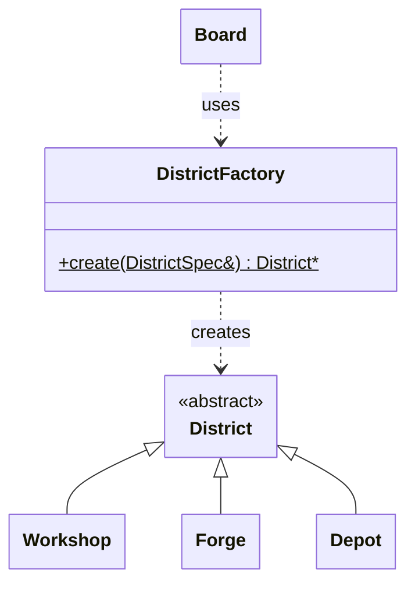
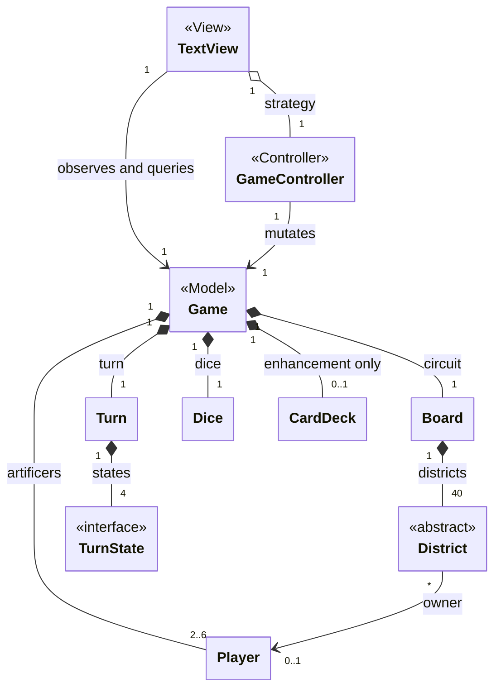

# ArcaneMarket — UML class diagrams

Reflects the final submitted code. Rendered images in `diagrams/`.

**Level of abstraction: the minimal detail needed to demonstrate each pattern's uniqueness.**
Every box carries only the members that make its pattern identifiable — the roles, the
polymorphic hook, and the data that distinguishes the pattern from a plain class. Members that
exist but say nothing about the pattern are omitted, exactly as the course chapters do when they
draw their own figures (Chapter 20's `Light` receiver shows only `setLevel` and `level`, not
everything a Light can do).

## Notation (Chapter 8)

| Symbol | Meaning | C++ here |
|---|---|---|
| `+ - #` | public / private / protected | |
| *italics* | pure virtual | `= 0` |
| <u>underline</u> | static | `static` |
| `const` | query operation | `... const` |
| ◁—— | generalization | `class B : public A` |
| ◆—— | composition | by value or `unique_ptr` |
| ◇—— | aggregation | `shared_ptr` |
| ——▶ | association | non-owning reference or raw pointer |
| ⋯▶ | dependency | creates / uses |

Multiplicities appear at both ends of every association, since Chapter 8 notes that a final
diagram should not leave them blank.

---

## 1. MVC + Observer — `Game`, `TextView`, `GameController`

Chapter 17 treats MVC as a compound pattern, so it is drawn as one figure. What makes this MVC
rather than three arbitrary classes is the direction of every link: the **View owns the
Controller** as its strategy, the **View observes the Model**, the **View queries the Model
directly** on redraw, and the **Model names no View at all** — it only fires
`notifyObservers()`.

---

## 2. Template Method — resolving a visit to an ownable district

The uniqueness is one `final` operation that fixes an invariant sequence, and one pure virtual
hook that is the only step allowed to vary. Nothing else about a district demonstrates that, so
nothing else is drawn.

`landOn` is the template method and is `final`: it fixes the sequence — unowned? owned by the
visitor? mortgaged? otherwise charge — and `computeToll` is the only step that varies.

The nine non-ownable districts also derive from `District` and override `landOn`, but they take
no part in the Template Method and are omitted here.

---

## 3. State — the phases of a turn

The uniqueness is that the Context **owns every state for its whole life** and swaps a
non-owning pointer, rather than allocating on transition, and that each state holds the Context
back-reference so it can drive its own transitions.

`Turn` delegates every action to `state_`; the four states are built once in its constructor and
never reallocated.

Turn phases and their transitions:

---

## 4. Command — the interpreter

The uniqueness is that each concrete command **binds its receiver and its arguments as data
members at construction**, so the Invoker can fire any request through one interface without
knowing what it is. The bound members are therefore the detail that matters; three of the
thirteen commands are shown as representatives.

`Command` declares `execute()` only. Chapter 20 adds `undo()` **when undo is required**, and
ArcaneMarket has no undo. `MessageCommand` is the one command with no receiver: it reports a
refusal.

Ten further commands follow the same shape: `Next`, `Mortgage`, `Unmortgage`, `Upgrade`,
`Accept`, `Reject`, `Insolvent`, `Assets`, `All`, `Save`.

---

## 5. Simple Factory — building the circuit

Drawn to show what it **is not**: one concrete creator with a static operation, and no creator
hierarchy. That absence is the point, because it is what distinguishes the Simple Factory idiom
from the GoF Factory Method (Chapter 12).

---

## 6. Structural context — how the patterns compose

Names only, since the relationships are the whole content of this figure: which object owns
which, and therefore what dies with what.

Composition (filled diamond) everywhere the owner holds the part by value or by `unique_ptr`;
aggregation (hollow diamond) for the one `shared_ptr`; plain association for the non-owning
`Player*` an ownable district keeps to record its owner.
